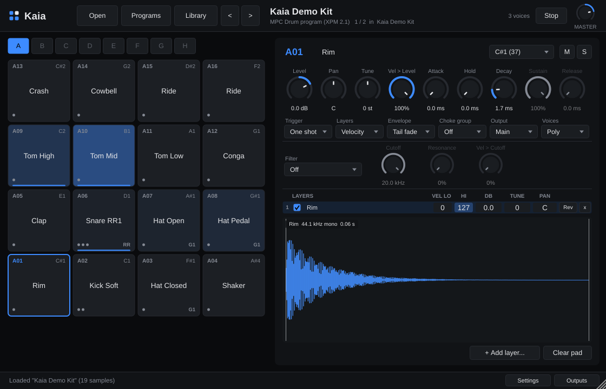

<h1>
  <picture>
    <source media="(prefers-color-scheme: light)" srcset="Resources/Logo/kaia-logo-light.svg">
    
  </picture>
</h1>

**Kaia is a fast, lightweight drum sampler that plays Akai MPC programs and expansions directly.** It is built for Linux first (VST3, LV2, CLAP and a standalone app), with Windows and macOS builds produced by CI.



* Opens **.xpm** programs (MPC software 1.x/2.x XML and MPC 3.x compressed JSON),
  **.xpn** expansions (read straight from the archive, nothing to unpack), and **.pgm** programs
  from the MPC500/1000/2500, MPC2000/2000XL and MPC3000 (including `.SND` sounds).
* Also plays a folder of WAV/AIFF/FLAC/MP3/OGG files: one sample per pad.
* 128 pads in 8 banks (A–H) with the MPC pad layout and note map, up to 8 layers per pad.
* Velocity layers, round robin and random layers, choke groups, mono pads,
  one-shot / note-on / note-off triggering, envelopes, filters, tuning, reverse.
* 17 stereo outputs (Main + Aux 1–16) for multi-track drum mixing.
* **Electronic drum kits**: pick your module (Roland TD-10 and other V-Drums, Alesis, Yamaha DTX,
  General MIDI) and its drums play a fixed pad layout; edit the note map and save it as your own;
  **MIDI Learn** on any pad. The header shows every incoming MIDI note and its velocity.
* **Library browser**: point Kaia at the folder with all your expansions and samples, then load
  programs or mix and match single pads and samples from different expansions. Save the result
  as a **preset**; your library files are never modified.
* **Files browser**: explore any folder on disk as it is, hear samples with a click and drag them
  onto pads, without adding anything to the library.
* Real-time safe engine: no locks or memory allocation on the audio thread, every sample in RAM,
  high-quality windowed-sinc resampling. About 4–5% of one 2.1 GHz core for 50 simultaneous voices.

## Get it

### Prebuilt Linux binaries

Every push builds **Kaia-linux-x86_64**: open the latest successful *Build* run on the
[Actions](https://github.com/singularity098/kaia/actions) tab and download it under *Artifacts*
(GitHub wraps it in a zip; inside is `Kaia-linux-x86_64.tar.gz`). Tagged versions will also
appear on the [Releases](https://github.com/singularity098/kaia/releases) page once published. Then:

```sh
tar xzf Kaia-linux-x86_64.tar.gz
cd Kaia-linux-x86_64
./install.sh                    # for your user: ~/.vst3, ~/.lv2, ~/.clap, ~/.local/bin
# sudo ./install.sh --system    # or system-wide
# ./install.sh --uninstall
```

Rescan plugins in your DAW. Requirements: x86-64 Linux with **glibc 2.35 or newer**
(Ubuntu 22.04+, Debian 12+, Mint 21+, Fedora 36+, Arch, openSUSE Tumbleweed, …) and the usual
desktop libraries (FreeType, fontconfig, X11; ALSA/JACK/PipeWire for the standalone app).
Open `Kaia Demo Kit.xpn` (included in the archive) to check that everything works.

### Build from source

```sh
git clone https://github.com/singularity098/kaia.git
cd kaia
./build.sh --deps --install     # installs build packages (apt/dnf/pacman/zypper), builds, installs for your user
```

or by hand:

```sh
cmake -S . -B build -G Ninja -DCMAKE_BUILD_TYPE=Release
cmake --build build
# plugins end up in build/Kaia_artefacts/Release/{VST3,LV2,CLAP,Standalone}
```

JUCE 8 and the CLAP extensions are downloaded automatically during the first configure.

| CMake option | Default | |
|---|---|---|
| `KAIA_BUILD_CLAP` | ON | CLAP plugin |
| `KAIA_BUILD_TESTS` | ON | `KaiaTests`: parser and engine tests |
| `KAIA_PORTABLE_LINUX` | OFF | static libstdc++ and a glibc 2.35 baseline, for redistributable binaries |
| `KAIA_BUILD_HOST_TEST` | OFF | developer tools: host test harness and UI snapshot renderer |
| `KAIA_JUCE_DIR` | | use a local JUCE checkout instead of downloading |

## Using Kaia

* The header's tabs are **Open**, **Files**, **Library** and **Programs**, with `<` `>` next to
  Programs. Click Files, Library or Programs again (or *Done*) to go back to the pad editor.
* **Open** a program (.xpm/.pgm), an expansion (.xpn), a folder, or audio files — or drag any of
  them onto the window. Recent files are under *Open → Recent*.
* **Programs** lists every program in the open expansion or folder; click one or use the arrow
  keys to switch kits. `<` and `>` step through them.
* **Pads**: click to play (higher on the pad = harder hit). Right-click for load/copy/paste/clear.
  Drop audio files on a pad to replace its sample; several files become round-robin layers.
* **Pad editor**: level, pan, tune, velocity sensitivity, envelope, filter, trigger mode, layer
  mode, choke group, output and mono/poly, plus per-layer velocity range, level, tuning, pan and
  reverse. Double-click a layer to replace its sample.
* **Outputs** routes pads to Aux 1–16 for separate mixer channels. In VST3 hosts, enable the
  plugin's extra outputs (Reaper: pin connector; Bitwig: add chains per output). LV2 and CLAP
  always expose all 17 outputs. If an aux output is switched off in the host, its pads play through
  Main, so nothing goes silent.
* **Library** (header): set your library folder once (*Folder…* or *Settings*), and Kaia scans it
  in the background: every `.xpn`, every folder with programs, and every folder of samples, listed
  at the top level. Click an expansion to open it: its *Programs* and *Samples* open with it (click
  them, or a heading, to close them; the triangle next to a program shows its pads). **Click a program** (or preset) to load it. With *Click to hear* on,
  clicking a sample or pad plays it, again on every click. Double-click a sample or pad to put it
  on the selected pad (named at the bottom of the list), or **drag** it onto any pad
  (hold Shift while dropping a sample to add it as a layer). This is how you mix and match
  sounds from different expansions. The search box searches programs and samples of the whole
  library (the **×** at its right clears it, as does Escape). The scan is cached in the config folder, so it's instant next time.
  The list starts fully collapsed; **Expand all** / **Collapse all** next to the search box opens
  or closes every pack. Click the **☆** at the right of a program or sample to make it a
  favourite, and the **☆** next to the search box to list only your favourites (the search then
  searches them). Programs that come with a preview render (MPC expansions keep them in
  `[Previews]`) get a **▶** button that plays it; while it plays the button becomes **■** in the same
  place, so a second click stops it.
  **Tiles** switches to a cover-art view of your packs (2, 3 or 4 columns; the search box filters
  packs by name). Tap a pack to load it; switch back with **List** and that pack is open there.
* **Files** (header): a plain file explorer that starts in a folder of your choice (*Folder…* or
  *Settings → Library → Files tab*; until you choose one it starts in the library folder). It shows
  folders, samples, programs and expansions as they are on disk; nothing is scanned or added to the
  library. Click a folder to open it, **click a sample** to hear it, click a program or expansion to
  load it; double-click a sample or **drag** it onto a pad to use it, as in the Library. The filter
  box shows only the files whose name or folder path contains every word you type (the **×** clears
  it); the folder is read again each time you show the tab.
* **Presets**: *Open → Save preset…* stores the current kit (all pads, layers and settings) in
  Kaia's config folder. Presets appear under *Open → Presets* and at the top of the Library.
  A preset refers to the samples where they are in your library; Kaia never copies, moves or
  changes library files.
* **Drum modules** (*Settings → Drum module*): choose your e-drum module and its default notes
  are mapped to this layout, whatever the program's own note map:

  | | | | |
  |---|---|---|---|
  | A13 Ride | A14 Ride bell | A15 Crash 2 edge | A16 Crash 2 |
  | A09 Tom 4 (floor) | A10 Tom 3 | A11 Tom 2 | A12 Tom 1 (high) |
  | A05 Snare rim | A06 Cross-stick | A07 Crash 1 | A08 Hi-hat open |
  | A01 Kick | A02 Snare | A03 Hi-hat closed | A04 Hi-hat pedal |

  Tom rims and the ride edge play the same pad as the head/bow. Roland and Alesis hi-hat edges
  (22 closed, 26 open) play the closed/open hi-hat pads, and the open hi-hat notes (46, 26) play
  both A08 and A04, so an open hi-hat can be layered from two pads. Closed and pedal hi-hat cut
  off the open hi-hat (switchable); pads hit by the same note never cut each other. Notes the
  module doesn't send are ignored. Roland TD-10: 36 kick, 38 snare, 40 rim, toms 41/39 →
  A09 up to 48/50 → A12, 42/22 closed hi-hat, 46/26 open hi-hat, 44 pedal, 49/59 → A13,
  55 → A16, 52 and 10 → A15; 51, 53 and 57 play nothing (crash 1 and the ride bell stay free
  unless you add notes in Settings).
  Supported: Roland TD-3/6/8/10 and TD-1/02/07/4/9/11/12/15/17/20/25/27/30/50 and VAD,
  Alesis Nitro/Turbo/Surge/Command/Crimson/Strike/Strata/DM10, Yamaha DTX400–DTX10 and DTX-PRO,
  and the General MIDI drum map (EFNOTE, Simmons, ATV, Millenium and most others). These are the
  factory default notes. Keygroup (melodic) programs always keep their own key ranges.
* **Your own drum maps**: the settings page shows which notes play each pad and the last note
  received. Click a pad there to *Learn* a note (hit the drum), type its notes, or remove them;
  a note can play several pads. *Save as custom map…* stores the result under your own name in
  the config folder (`drum-maps/`); it then appears under *My drum maps* in the module list.
  *Restore factory notes* undoes edits to a built-in module. Projects store the map they use,
  so they play the same on another computer.
* **MIDI Learn**: right-click a pad → *MIDI Learn*, then hit the drum (or key). That note now
  plays the pad, on top of the module map or the program's notes. *Forget learned notes* is in
  the same menu and in Settings.
* **Highlight colour**: *Settings → Highlight colour* (blue by default).
* **Pad colours**: *Settings → Pad colours* tints the pads with a soft gradient that runs from A01
  to A16 (blue, cyan, green, orange, red, pink or purple), independently of the highlight
  colour. *Plain* (the default) keeps them neutral.
* **Sample loops**: off by default (*Settings → Playback*), so every hit plays its sample once.
  Some samples carry loop points; with *Play sample loops* on, pads in note-on mode repeat them
  for as long as the note is held.
* **Touch screens**: drag lists (library, programs, settings) with a finger to scroll; flick the
  library and it keeps gliding (*Settings → Library → Touch scrolling fling*: 0 stops when you
  let go, 10 glides furthest; a tap stops it). Drag a sample or pad sideways onto the pads to use
  it. Library items play when you lift your finger, so scrolling stays silent. The *Play* button under the waveform plays the selected pad.
* **Header**: the open expansion's artwork (click it for its program list), the last MIDI note
  received with its velocity (it flashes on every hit); click the Kaia logo to open this GitHub page.
* **Saving**: the DAW project stores the kit and every pad edit. Samples are referenced from their
  original location, not copied into the project; if you move your library, use **Relink…** and
  point it at the new folder.

### Envelope modes

* **Tail fade** (MPC "decay from end"): the sample plays fully; *Decay* fades out its tail. This is
  the MPC default for drums.
* **Decay** (MPC "decay from start"): the sound fades out over *Decay* right after the attack —
  use it to shorten hits.
* **AHDSR**: classic envelope with sustain; *Release* starts when the note ends (note-on mode).

## Where Kaia keeps its files

Settings, presets and the library index live in one folder:

* Linux: `~/.config/kaia/` (or `$XDG_CONFIG_HOME/kaia/`)
* macOS: `~/Library/Application Support/Kaia/`
* Windows: `%APPDATA%\Kaia\`

`settings.xml` (recent files, library and Files tab folders, drum module, learned notes, colours,
loops, library view and fling),
`presets/*.kaiapreset`, `drum-maps/*.kaiamap` (your own drum maps), `favourites.txt` (starred
library programs and samples) and `library-index.xml`. Kaia 1.0 kept its settings in `~/Kaia/`;
they are moved automatically. Kaia never writes anywhere else, and in particular never into your
sample library or expansion files.

## Latency

Kaia adds **no latency**: it reports zero latency to the host and a hit starts sounding at the
exact sample position of the MIDI note within the current audio block. Drum-module mapping and
MIDI Learn are a table lookup on the note; nothing is buffered. What you hear is your audio
interface's buffer: for playing e-drums live use a small buffer (64–128 samples at 48 kHz, i.e.
1.3–2.7 ms), which Kaia's low CPU use makes practical.

## Format support

| Format | What is read |
|---|---|
| **XPM (MPC 2.x XML)** | drum and keygroup programs, pad note map, up to 8 layers, velocity ranges, layer play mode (velocity / cycle / random), mute groups and mute targets, simultaneous-play targets, trigger mode, mono/polyphony, level/pan/tune (pad and layer), velocity sensitivity, amp envelope (AD / AHDSR, decay from start/end), filter type/cutoff/resonance/velocity, sample start/end/slices, reverse, loops (note-on mode), keygroup root notes and key tracking |
| **XPM (MPC 3.x JSON)** | the same, from the compressed format MPC 3 firmware writes; samples in `<program>_[ProgramData]` are found automatically |
| **XPN** | zip expansions including Zip64 (> 4 GB); programs and samples are read directly from the archive; title, manufacturer and cover art are shown |
| **PGM MPC500/1000/2500** | 64 pads × 4 samples, velocity ranges, tuning, play mode, voice overlap, mute groups, attack/decay/decay mode, filter, velocity → level/cutoff, mixer level/pan, pad note map |
| **PGM MPC2000/2000XL** | per-note sound, tuning, attack/decay/decay mode, cutoff/resonance, velocity → level, velocity-switch and simultaneous modes, voice overlap, mute assigns, mixer level/pan, pad → note map; `.SND` and `.WAV` sounds |
| **PGM MPC3000** | the same note parameters as the 2000XL, MPC3000 `.SND` sounds |

Samples are matched the way an MPC does: by name, case-insensitively, next to the program first,
then in sub-folders, then in a sibling folder (for the common `Programs/` + `Samples/` layout).

Not reproduced: MPC insert effects, LFOs, pitch and filter envelopes, Q-Link assignments,
warp/time-stretch, the MPC2000XL "decay switch" mode (played as a normal note) and the MPC's
individual-output routing (all pads start on Main; use **Outputs** to route them).

**Copy-protected expansions**: some commercial expansions are encrypted so that only Akai's
software can open them. Kaia detects them and says so; it does not try to unlock them.

## Quality checks

* `KaiaTests` builds synthetic programs in every supported format, loads them, renders MIDI
  through the engine and checks the audio: velocity layers, round robin, chokes, tuning,
  resampling, reverse, note-off behaviour, multi-out routing, state round trips, keygroups,
  zero heap allocations on the audio thread, CPU use, and fuzzed garbage input. With
  `--real-data <folder>` it also runs against real MPC files.
* Release binaries are checked with pluginval (strictness 10, VST3), clap-validator (CLAP), and a
  host harness (`KaiaHostTest`) that loads the built VST3 and LV2 like a DAW, plays every pad,
  restores saved state and checks multi-out routing.
* The test suite also passes under AddressSanitizer and UndefinedBehaviorSanitizer.

Set `KAIA_DEBUG=1` in the environment to print diagnostics from the plugin to stderr.

## Troubleshooting

* **"N samples not found"**: the program refers to samples by name; keep the pack's folder
  structure intact, or use **Relink…** to point Kaia at the folder that holds them.
* **Pads are silent in a multi-out setup**: a pad routed to an aux output plays only there if the
  host has that output enabled. Use *Outputs → All pads to Main* to reset.
* **E-drum pads play the wrong sound**: check *Settings → Drum module* and that your kit is laid
  out as in the table above; the header and the settings page show the last note received.
  Fix single drums by clicking the pad on the settings page (or with MIDI Learn).
* **A sound keeps repeating and the voice count climbs**: the sample has loop points and the pad
  is in note-on mode. Loops are off by default; check *Settings → Playback*. *Stop* silences
  everything.
* **Plugin doesn't load on an older distro**: the prebuilt binaries need glibc 2.35+; build from
  source instead.

## Contributing

See [CLAUDE.md](CLAUDE.md) for architecture, threading rules, format notes and the test/release
checklist.

## License

Kaia is free software under the GNU Affero General Public License v3 (see `LICENSE`). It uses
JUCE (AGPLv3), the VST3 SDK (GPLv3 option), the LV2 headers (ISC) and CLAP with
clap-juce-extensions (MIT), and the Jost font (SIL Open Font License). The logo's wordmark is drawn from the Michroma font
(SIL Open Font License). See [THIRD_PARTY.md](THIRD_PARTY.md).

MPC is a trademark of inMusic Brands. Kaia is an independent project, not affiliated with or
endorsed by Akai Professional or inMusic.
